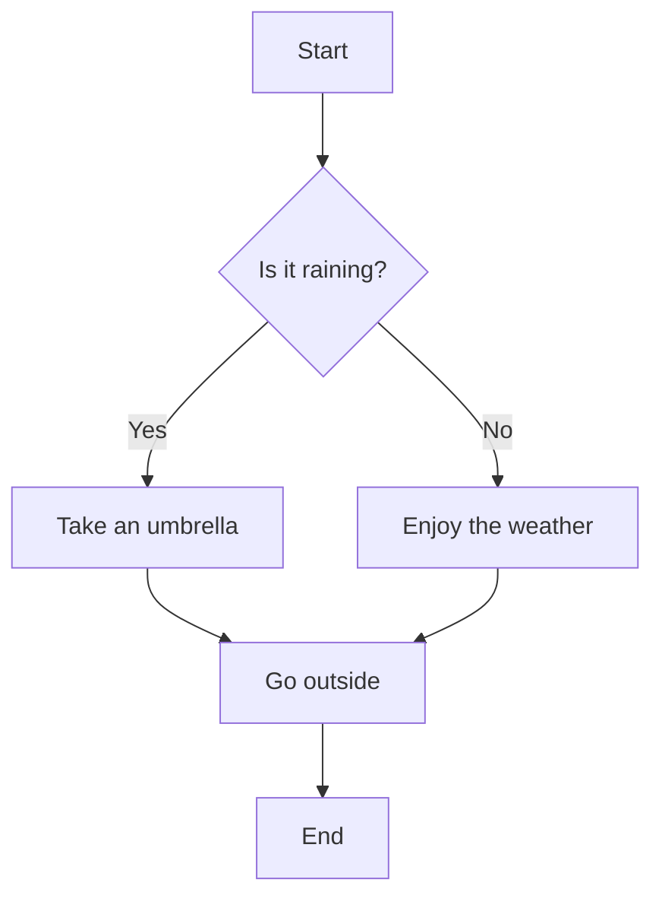
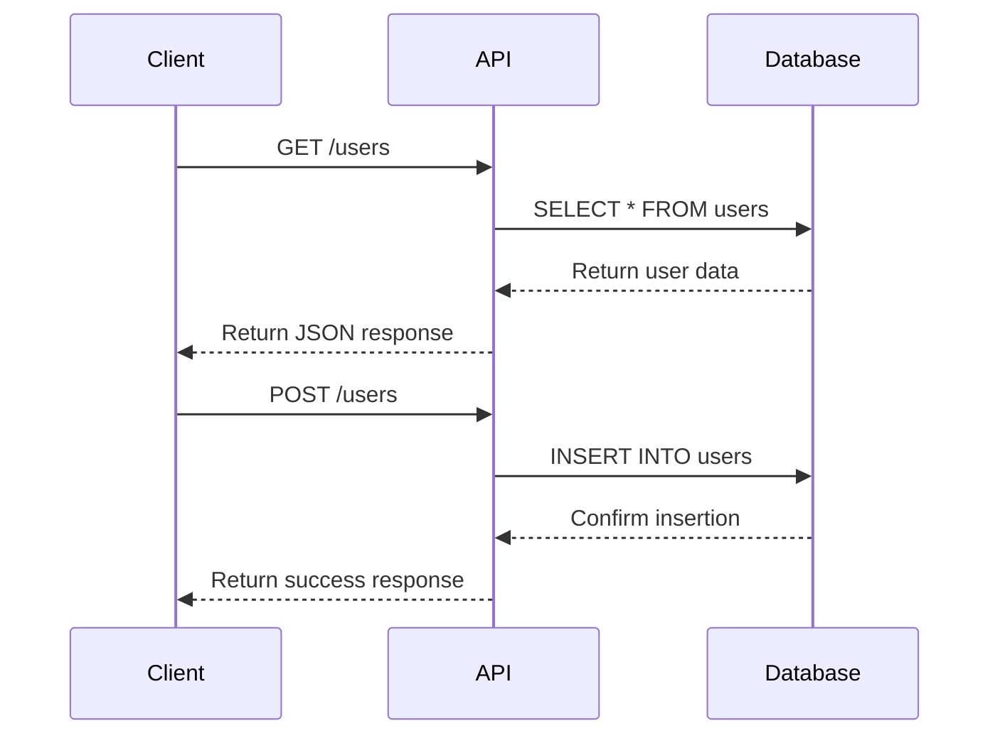
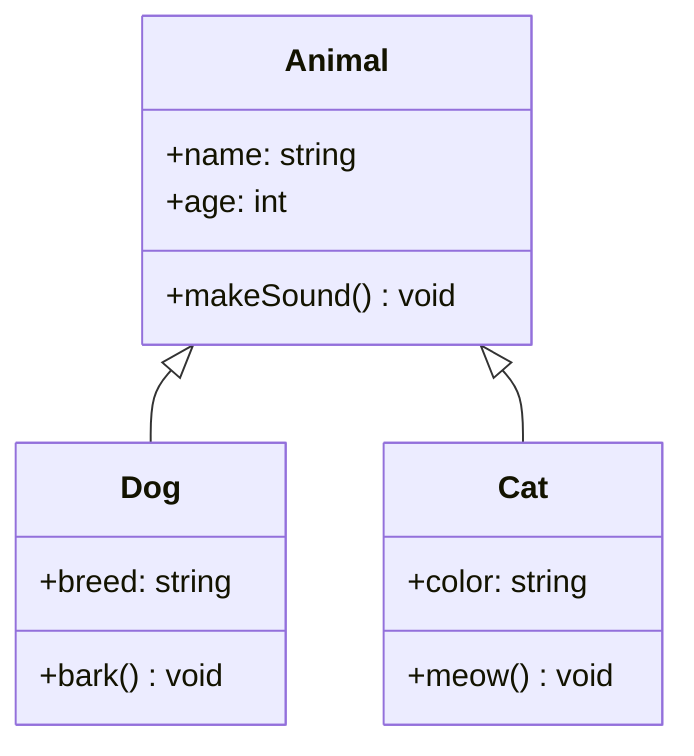
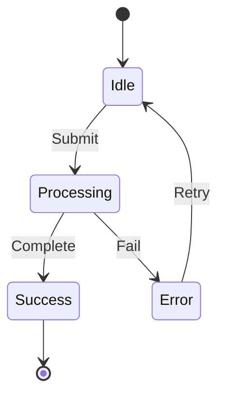
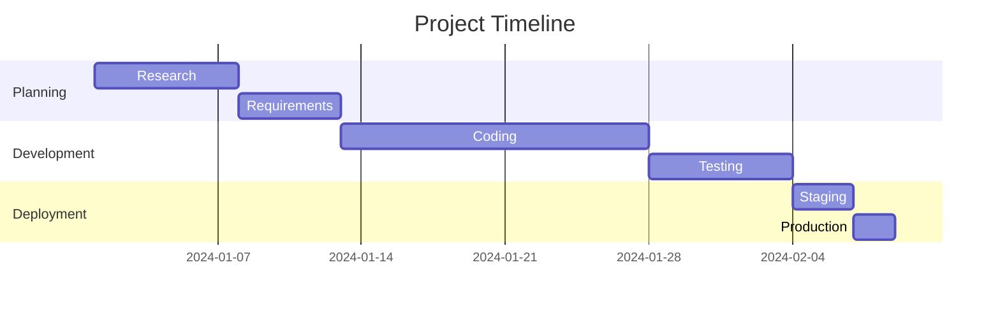
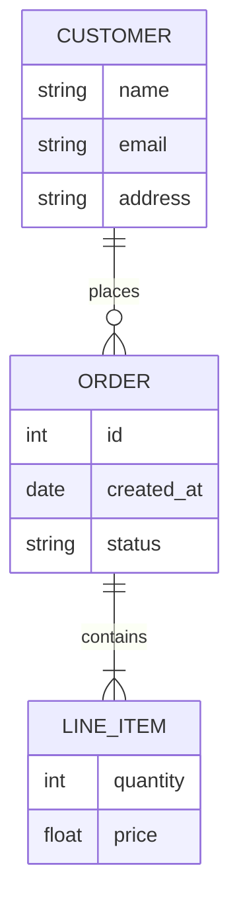

# Using Mermaid Diagrams in Technical Documentation

Diagrams are a powerful way to visualize complex concepts, workflows, and relationships in technical documentation. [Mermaid](https://mermaid.js.org/) is a JavaScript-based diagramming and charting tool that allows you to create diagrams using Markdown-inspired text. In this post, I'll show you how to use Mermaid diagrams in your blog posts with various examples.

## Why Use Mermaid?

- **Simple Syntax**: Create diagrams using a Markdown-like syntax
- **Variety of Diagram Types**: Flowcharts, sequence diagrams, class diagrams, state diagrams, and more
- **Version Control Friendly**: Diagrams are defined as text, making them easy to version control
- **Customizable**: Adjust colors, styles, and layouts to match your design
- **Easy Integration**: Works well with Markdown and static site generators

## Flowcharts

Flowcharts are perfect for illustrating processes and decision-making workflows. Here's a simple example:

## Sequence Diagrams

Sequence diagrams show how processes operate with one another and in what order. Great for API documentation:

## Class Diagrams

Class diagrams are useful for showing the structure of a system:

## State Diagrams

State diagrams help visualize different states of a system:

## Gantt Charts

Gantt charts are perfect for project timelines:

## Entity Relationship Diagrams

ER diagrams help visualize database structure:

## Conclusion

Mermaid diagrams are a powerful tool for enhancing your technical documentation and blog posts. They provide a visual representation of complex concepts that might be difficult to explain with text alone. With the simple Markdown-like syntax, you can quickly create beautiful diagrams without leaving your text editor.

Try adding Mermaid diagrams to your next blog post to make your content more engaging and easier to understand!
